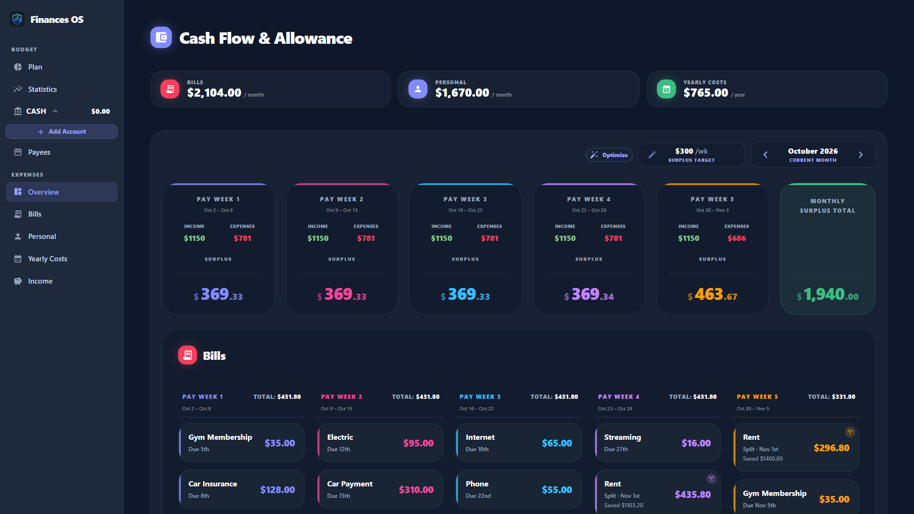

# Finances OS

<p align="center">
  <a href="https://deweyhammers.github.io/finances-os/">
    
  </a>
</p>

<p align="center">
  <a href="https://deweyhammers.github.io/finances-os/"><b>📖 Take the picture tour →</b></a><br>
  <sub>From an empty install to a fully planned month, step by step (all sample data is made up).</sub>
</p>

A personal cash-flow workstation for planning your paycheck against monthly bills. Pay periods are calculated from the real calendar based on your configured pay day, and the dashboard shows income vs. expenses for each period at a glance.

The app opens on the **Plan** (zero-based budget) by default. Other sections live under **Budget** (Plan, Statistics, Payees), **Cash** (per-account ledgers), and **Expenses** (Overview, Bills, Personal, Yearly Costs).

## Core Features

### 🧮 Plan

- Monthly **zero-based budget** table: every dollar of income gets assigned a job.
- Sticky **Ready to Assign** pill at the top, color-coded (green = balanced, yellow = unassigned, red = over-assigned).
- **Category groups → items**, drag-reorder within and across groups.
- **Subsections** (one level deep) can live inside a group to sub-organize items — items can sit directly in the group or in a subsection.
- **Three modes for adding items:** pull from existing **Bills**, pick a **Personal** name, or type a **Custom** item with name + amount.
- **Auto-Assign** popover fills the right amount for every sourced item in one click, scoped to the **current pay week** only. Bill due days are clamped to the last valid day of the current month before period matching.
  - **Weekly-allowance items** (`repeatWeekly` personals such as Gas or Spending) always receive a fresh flat per-period amount — clicking for Pay Week 2 always adds exactly one week's worth regardless of prior assigned state.
  - **Split bills & split personals** (multi-week `BillSplit` rows, `splitAcrossWeeks` personals) use **cumulative top-up**: the target is the sum of all per-week slices through the clicked pay week, and prior weeks' funding is subtracted from what gets added. Clicking Auto for Pay Week 3 on a split bill correctly tops up whatever's still owed by end of week 3 — even after Pay Weeks 1 and 2 have already contributed their shares.
  - **Single-week bills** get their full amount only when auto-assigning their natural pay week.
- Inline-edit the **Assigned** cell; calculator-style (`+50` to add) supported.
- **Move Money** popover off any Available pill to cover overspending YNAB-style.
- Activity + Available are derived live from your transactions.
- **Out-of-sync ⚠ badges + Sync Plan button** — Bill envelopes flag with an amber warning icon when their funding drifts from the Overview's schedule (fires for both OVER and UNDER). Hovering explains the shortfall or excess in "still-to-save" terms. A **Sync Plan** button (top-left of the Plan page, mirroring Add Group on the right) applies every delta in one click: pulls extra back to Ready to Assign, tops up under-funded envelopes from RTA. Disabled when RTA can't cover the shortfall — tooltip shows how short you are. Both the badge and the button are silenced on payday-morning "haven't assigned this week's paycheck yet" cases (previous pay week's target was already met) so the Plan doesn't shout at you before you sit down to budget. Overview changes that redistribute splits mid-period naturally break the suppression → warnings return.

### 📊 Statistics

- Top-level tabs split the page by series: **Spending** (red) / **Income** (green). Default is Spending.
- Inner tabs flip between **Yearly Overview** (12-month stacked bar chart per item / per payee) and **Month-to-Month** (donut chart for the selected month with per-item / per-source breakdown on hover).
- KPI tiles per series: **{Year} Total**, **Monthly Average**, **Highest Month**. Spending also surfaces a **Saved This Year** tile — it sums every transaction categorized to a budget item literally named "Savings" (case-insensitive), with a subtitle showing the average per active month.
- Year and month pickers are chevron pills (←/→) inside each inner view. Each pill shows a **"CURRENT YEAR" / "CURRENT MONTH"** sublabel when the selection matches today (both computed in local time, not UTC).
- **Click a month** in any Yearly bar chart to drill into that month's pie in the Month-to-Month view (same series).
- Income is detected as any `AccountTransaction` with `memo.trim().toLowerCase() === "income"` and positive `inflowCents`, grouped by payee.

### 💵 Cash & Accounts

- Manual **Accounts** (Checking, Savings, etc.) with derived balances — never out of sync with your transactions.
- Editing an account's **Working Balance** writes a tagged adjustment transaction so Ready to Assign tracks reality.
- Per-account **transaction ledger** with date, payee, category, memo, outflow, inflow.
- **YNAB-style search** above each ledger — a single input filters across payee, category (live name or post-deletion snapshot), memo, and inflow/outflow amounts (supports `$1,234.56`, `1234.56`, and `1234` formats).
- **Date+time sort** — new transactions stamp the current time-of-day onto the picked date so today's entries land at the top of the same day; edits preserve the original timestamp unless the date changes.
- **Category snapshot on delete** — deleting a `BudgetCategoryItem` first snapshots its name onto every linked transaction (`AccountTransaction.categoryName`), so the historical category remains visible (rendered italic + "(deleted)" suffix) after the relation is severed.
- **Payees** library with freeSolo Autocomplete — typing a new name auto-creates a payee; deletes set transaction payee to null without losing the transaction.
- Sidebar shows **Cash $TOTAL** with each account name + live balance and a hover-pencil that opens an edit modal in place.

### 📅 Expenses

- **Overview:** Landing page with three at-a-glance **summary tiles** at the top (**Bills** $/month, **Personal** $/month, **Yearly Costs** $/year — colored by section), followed by a **Monthly** section (month navigator + Surplus Target pill + Optimize button + Cash Flow & Allowance pay-week cards + Bills + Personal) and a **Yearly Costs** section below it. Every hover tooltip across the page (cash-flow breakdowns, split badges, warnings) shares the same dark-bg + section-colored-border visual language via `renderer/lib/tooltip-styles.tsx`.
  - **Month navigator** (`< June 2026 >`) lets you browse any month; defaults to the current month and shows a "CURRENT MONTH" label when on it.
  - **Surplus Target pill** — a compact editor left of the month picker showing the minimum surplus each pay week should keep after bills and personal. Click the pencil to edit; Enter commits, Escape cancels, blur saves.
  - **Optimize button** — always-visible pill in the toolbar to re-run the pay-week balance on demand. Plans the next **36 months (3 years)** so future-month navigation stays fully funded.
  - **Try a sandbox button** — left of Optimize. Switches the whole app onto a copy of your database so you can cut a bill, bump the income or re-Optimize and see what happens, then **Discard** it or **Keep** it. See **Sandbox mode** below.
  - **Pay periods belong to their payday's month.** Each pay week starts on an in-month payday and runs until the day before the next payday. The last period of a month forward-extends into the next month up to the day before that month's first payday (e.g. July's P5 runs Jul 29 – Aug 4). There is **no backward extension** — bills due Aug 1-4 don't appear under August; they surface under July's P5 because Jul 29's paycheck funds them. This matches how the money actually moves.
  - **Multi-occurrence bills** — when a bill's next-month firing lands inside the forward extension AND the following view can't naturally cover it (its first payday falls after the due date), a bill can appear TWICE in one view. Example: in September 2026 a bill due the 4th appears in P1 for Sep 4 (in-month, natural) AND in P5-area splits for Oct 4 (Oct's first payday is Oct 7 — too late to fund Oct 4, so September must pre-save). Each occurrence is placed independently by the balancer.
  - **Orphan skip** — the algorithm refuses to double-count a payment across two views. If a bill's next-month firing IS naturally covered by the next view (that view's first payday ≤ due date), the current view leaves it alone.
  - **Auto-Balance** — every time the view loads or bills/income/personal/target change (or a legacy `occurrenceCoord=0` split is detected), the app can re-plan which pay week funds each bill. Per-occurrence placement then iterative-split leveling: worst-shortfall week gets its largest splittable bill spread across the eligible **open** weeks. The goal: every pay week retains **≥ the surplus target** as surplus after bills + personal. When the target is unreachable given income, some weeks fall short but the plan still runs.
  - **Locked weeks** — a pay week locks as soon as it **starts** (its paycheck has landed and been handed out), so the current week is locked too. Optimize keeps locked weeks' splits exactly as they are and never plans new money into them.
  - **Pre-saving next month's first-week bills** — bills due in the first pay week of a month (say the 4th–6th, when the first payday is the 4th) have no earlier week in their own month to level into, so each month's open pay weeks save ahead for them. The slices show in the prior month as `Split · Dec 4th` cards; the firing month's first-week card shows the remainder with a cumulative `Saved` line. Attribution is unchanged (each firing is still counted in exactly one view), so the first week of every month ends up level with its neighbours instead of carrying the whole cluster.
  - **Skipped bills** — if a bill only fits into an already-locked week (e.g. its due date was moved into the current week, or its price went up after payday), it isn't planned this cycle: that paycheck is already spent, so you cover it outside the plan. Its card shows dimmed as **"Skipped · added after payday"** at $0.00, and the next month's occurrence is planned normally.
  - **Underfunded invariant** — `assertNoUnderfundedBills` throws if any bill occurrence ends up with `allocations + locked cents < bill.amount`. Skipped occurrences are exempt.
  - **Safe writes** — Optimize plans all 36 months in memory before touching the database, so a failure leaves your data unchanged and shows an error toast instead of a half-written plan.
  - Balance splits live in a `BillSplit(billId, monthKey, weekIndex, amountCents, occurrenceCoord)` table (one row per bill-occurrence per week per month). They're recomputed automatically; no manual controls.
  - **Stale-data alert** — amber warning banner appears whenever bills / income / personal / surplus target differ from what was last optimized — including edits made on other pages before you open Overview — or when legacy split rows are detected. The "last optimized" baseline is stored in the database (`AppSettings.optimizedInputsSig`), so every window agrees. It clears after a successful **Optimize**, or by itself if you revert the change. A toast confirms success or reports the error.
- **Bills:** Recurring monthly bills with a name, amount, and due day. Grouped into pay-period windows via auto-balance (funded-by-paycheck attribution). Due days past the end of the current month clamp to the last valid day for both display AND occurrence-coord math (a bill due the 31st fires on Sep 30 in September, not "Oct 1"). Card subtitles read `Due 5th` for in-month occurrences and `Due Oct 4th` for next-month/forward-extended ones so a bill firing twice reads as distinct dates. Split cards show `Split · Oct 4th` on the header, with a `Saved $X` line on non-first slices (first-slice cards omit it — the card's own amount IS the saved figure). The bill total lives in the CallSplit badge tooltip.
- **Personal:** Personal/household items with a name, amount, and one of three **cadences**:
  - **Fixed Week / Day** — fires on a specific `weekOfMonth` (1-4) or a day-of-month.
  - **Every Pay Week** — full amount hits every pay period.
  - **Split Monthly** — `amount` is a **monthly total** that gets distributed across pay weeks proportional to each week's leftover room after bills + fixed personal + surplus target. Splits are computed after the auto-balance runs so they only consume genuinely spare cash and never breach the surplus target. Great for savings goals ("$100/mo into Savings, spread wherever it fits").
- **Yearly Costs:** Annual expenses scheduled by month and day.

### 🔬 Sandbox mode

Try changes without risking your real data. **Try a sandbox** (Overview toolbar) copies the database to `sandbox.db` beside the real file and points the app at the copy; an amber **Sandbox** banner stays pinned across every page while it's active. Everything works as normal in there — edit or delete bills, change the income, Optimize, assign on the Plan page.

- **Discard** goes back to the real data and deletes the copy. The confirmation says how many transactions were recorded in the sandbox, since those are the edits most likely to be real.
- **Keep** replaces the real data with the sandbox. A timestamped `.bak` of the real file is written first (same naming as `db:pull` / `db:push`), so even Keep can be undone by hand.
- Closing the app always throws the sandbox away; a copy left behind by a crash is deleted on the next start, so the app always opens on real data.

### ⚙️ Income & Auto-Balance Settings

- **Income Sources:** Define one or more income sources, each with its own name, amount, payment cycle (Weekly / Bi-Weekly), pay day (Mon–Fri), and biweekly offset (1st & 3rd vs. 2nd & 4th weeks). The **Primary** income drives the pay-period windows used throughout the Plan and Overview.
- **Weekly Surplus Target** — configured inline via the Overview's Surplus Target pill (`AppSettings.wifeWeeklyTargetCents` — DB column name kept for backward compat, default $300). Changing it triggers an auto-balance re-run for the current month.

## 🧪 Tests

```bash
npm test           # Run the suite once
npm run test:watch # Watch mode
npm run test:ui    # Vitest UI dashboard
```

Vitest + Testing Library + Supertest. **269 tests** in the repo covering the budget math (cents, activity, available, RTA, auto-assign period resolver, move-money, balance adjustments), the pay-period calendar logic (payday-month attribution, `getBillPeriodKey`, `getBillOccurrencesInView` multi-occurrence enumeration, `clampDayToMonth`, override lookup, `balancePayWeeks` per-occurrence placement + locked-week skipping, `distributeSplitAcrossWeeks` largest-remainder rounding), a **full-year cross-view coverage invariant** (every real-world firing of every user bill from Aug 2026 → Jul 2027 is attributed to exactly one view — no double-count, no drops), a **locked-allocation preservation regression** (past-week partial payments count toward remaining amount, algo never re-places the full bill), an **Oct 2026 regression suite** built from real data (no new money into locked/current weeks, bills moved into the current week are skipped), **pre-saving** (a bill due the 4th with a first payday on the 4th is leveled across the prior month's open weeks, locked weeks untouched, the firing counted once, Auto-assign and the Plan ⚠ badge agreeing with the Overview), the form components (AssignedCell, PayeeAutocomplete, SiderAccountRow), and the API server over real HTTP against a throwaway SQLite copy (CRUD shape, body coercion, the Income single-primary rule, the loopback/Origin/Host gate, and **sandbox mode**: enter → discard leaves the real data untouched and deletes the copy, enter → keep replaces it with a `.bak` beside it, wrong-state calls are rejected).

Every `git push` runs the whole suite first (`.githooks/pre-push`); a failing test cancels the push. A further set of **lock-in tests** pins the Overview, Plan and Optimize output on a frozen copy of real data; they're gitignored because the repo is public, so fresh clones run the 269 above and the author's checkout runs more.

## 🛠 Technical Architecture

- **Desktop Core:** **Nextron** (Electron + Next.js) for a native desktop experience.
- **Backend:** Self-contained **Express API** running inside the Electron main process (port 5858).
- **UI Framework:** **Refine** + **Material UI (MUI)** with a custom dark theme.
- **Data Layer:** **Prisma** + local **SQLite**.
- **Production Storage:** Database lives at `%APPDATA%\finances-os\database.db` so data survives app updates.

## 🚀 Running the App

### Production Mode (Recommended)

The installer for each version is built by GitHub Actions (`.github/workflows/release.yml`) on a hosted Windows runner and attached to the matching [GitHub Release](https://github.com/DeweyHammers/finances-os/releases). To cut a release: bump `version` in `package.json`, merge to `main`, then tag and push (`git tag v1.2.0 && git push origin v1.2.0`). The workflow runs the test suite, builds, and publishes. "Run workflow" on the Actions tab builds any branch without releasing and keeps the installer as an artifact. The Release carries `latest.yml` beside the installer: from v1.3.0 on, Settings → General → **Check for updates** downloads and installs the next release from inside the app (click **Restart to update**); older installs download the installer from the Release page. Building on a runner also sidesteps Windows Smart App Control, which blocks electron-builder's unsigned NSIS stub on a PC where it's enforced — and, until the installer is code-signed (see below), blocks the installer itself on such a PC, whether the app or the browser downloaded it; the app detects the setting and says so in Settings → General instead of attempting the install.

### Code signing policy

Free code signing provided by [SignPath.io](https://signpath.io), certificate by [SignPath Foundation](https://signpath.org). Windows installers and portable builds attached to a GitHub Release are signed through SignPath from the exact commit the Release is tagged on, built by this repository's GitHub Actions workflow; nothing is signed from a developer PC. The signing step is being set up (SignPath Foundation application in progress, Oct 2026) — a Release built before it lands is unsigned.

- **Privacy:** the app sends no data anywhere. Everything stays in a SQLite file on your device, or — only if you turn sync on — in a database you own. There is no telemetry, no account, no crash reporting.
- **Maintainer:** Richard Dewey Hammers ([@DeweyHammers](https://github.com/DeweyHammers)); the only person with signing and release rights.
- **Code of conduct:** contributions follow the [SignPath Foundation Code of Conduct](https://signpath.org/terms).

To build locally instead:

1. **Build:**
   ```bash
   npm run build
   ```
2. **Launch:**
   - Run `dist\win-unpacked\Finances OS.exe`, or
   - Use the desktop shortcut created by the setup script.

3. **Shortcut Setup (Bypassing Windows Smart App Control):**
   Windows 11 may block local unsigned executables. To bypass safely while still using your production build, run:
   ```powershell
   powershell.exe -ExecutionPolicy Bypass -File setup-desktop-icon.ps1
   ```
   The shortcut launches via the **signed Electron host**, which Windows trusts.

### Development Mode

```bash
npm run dev
```

`nextron.config.js` sets `startupDelay: 60000` — without it Nextron 10 gives up on the renderer instantly ("Failed to start renderer process with port 8888 in 0ms") and leaves `next dev` running on port 8888.

### Syncing dev ↔ prod data

Two helper scripts copy the SQLite database file between the dev workspace and the installed app's userData. Both auto-back up the destination before overwriting (timestamped `.bak` file alongside it).

```bash
npm run db:pull   # copy %APPDATA%\finances-os\database.db  →  prisma\dev.db
npm run db:push   # copy prisma\dev.db  →  %APPDATA%\finances-os\database.db
```

When changing the Prisma schema, push to the dev DB and regenerate the typed client:

```bash
npx prisma db push      # apply schema to prisma\dev.db
npx prisma generate     # regenerate node_modules\.prisma\client (stop dev server first — Electron locks the engine DLL)
```

## 📂 Project Structure

- `/main` — Electron main process, Express API server and sandbox mode (`sandbox.ts`).
- `/renderer` — Next.js frontend (dashboard, lists, forms).
- `/shared` — Prisma client and shared utilities used by both processes.
- `/prisma` — Database schema and seed.
- `/resources` — App icons and platform assets.
- `/_archived` — Snapshots of removed/superseded features (e.g. the original EDD/Upwork build, the bi-weekly cycle model) preserved for reference or revert.

## 📄 License

[MIT](LICENSE) © 2026 Richard Dewey Hammers. Use it, change it, share it; no warranty.
